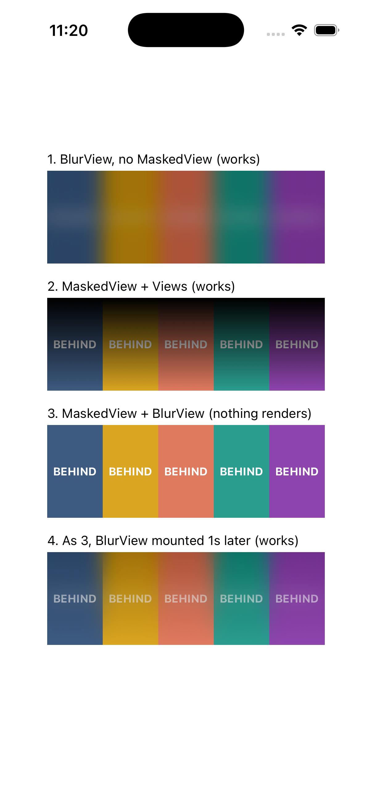

# expo-ui MaskedView + expo-blur repro

On iOS, an `expo-blur` `BlurView` inside `MaskedView` from `@expo/ui/community/masked-view` renders nothing when both mount together.

Run it:

```sh
npm install
npx expo run:ios
```

The screen shows four boxes over colored stripes. Boxes 2 to 4 use the same `expo-linear-gradient` mask, `'black'` to `'transparent'` from top to bottom.

1. `BlurView` without `MaskedView`: works.
2. `MaskedView` with a plain `View` child: works.
3. `MaskedView` with a `BlurView` child, mounted together: nothing renders.
4. Same as 3, but the `BlurView` mounts 1 second after the `MaskedView`: works.


